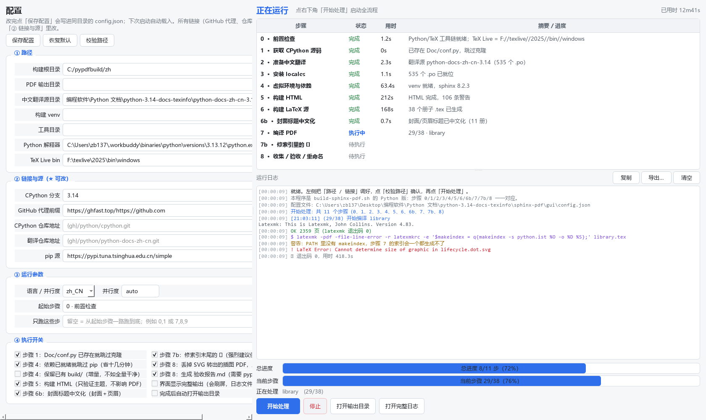

# Python 中文文档分册 PDF 构建器（PyQt6 图形界面）

> **2026-11-03**：单版本版 `pdf_builder_gui.py` 已**删除**，本程序（`pdf_builder_multi.py`）
> 是唯一实现 —— 只勾一个版本就是原来的「单版本」用法。本文下方仍保留一些
> 「单版本版 / 多版本版」的对比，作为历史说明；命令一律以 `pdf_builder_multi.py` 为准。

把 `sphinx-pdf/build-sphinx-pdf.sh`（一键 bash 脚本）和
`构建Python文档PDF-完整步骤.md`（分步说明）**完整搬进一个 Python 程序**，
换成图形界面：**左边改配置和链接，右边看每一步的实时进度**。

产出与参考样张一致：Python 中文分册 PDF，共 38 册 / 4000+ 页，
A4、Fandol 字体、书签齐全、目录带点线页码、索引无 ` `、
**非字母条目排在最前、每条索引页码可点、长条目不会压到隔壁栏**；
之后还能**把 38 册合并成一册（带完整书签）**、并**清理掉构建过程文件**。



> 图为左「配置 / 进度」整体布局。左侧配置面板后来精简成了
> **5 个可折叠区块**（详见 §三），截图未随更新重拍。

---
## ★ 多版本能力（现在就是主程序本身）

多版本能力已并入主程序：流水线（步骤 0\~10）与上文完全一致，
外面多了「版本多选 + 多进程并行 + 每版本独立日志面板 + 新命名规则」。

|需求|落点|
|-|-|
|3.13 / 3.14 / 3.15 **可多选**，选 2\~3 个就同时跑|① 版本与目录 → 三个勾选框；勾 ≥2 个时点「开始处理」弹出**多版本并行构建**窗口，一个版本一个独立日志面板（标题 + 复制 / 导出… / 清空，与主界面的「运行日志」一模一样），并排显示|
|三个分支**各用各的解释器**，避免互相踩|每个版本一行解释器：`D:\\\\\\\\软件\\\\\\\\Python313\\\\\\\\python.exe` / `Python314` / `Python315`（可改）。且**每个版本一个子进程**（`本程序 --cli --json-log --config <临时配置>`）—— venv、PATH、LC_ALL、工作目录天然隔离|
|文件夹带**详细版本号 + 日期**|`<基准目录>/Python 3.13.16 PDF 文档 20261017`（示例）。完整版本号**问解释器**得来（3.13.16 / 3.14.8 / 3.15.0），不写死|
|合并册带**详细版本号 + 日期**|`Python 3.13.16 文档 20261017.pdf`|
|基准 / 构建根 / 输出目录**默认放在一起**|基准目录默认 `C:\\\\\\\\Users\\\\\\\\zb137\\\\\\\\Desktop\\\\\\\\编程软件\\\\\\\\Python 文档`；构建根 = 基准/`Python <完整版本> PDF 文档 <日期>`；输出目录 = 构建根。开始前**自动建文件夹**|
|`0929 迁移到自由线程的稳定 ABI（abi3t）` 封面中文|`localize-titles` 的 `TITLES` 表新增 `howto-abi3t-migration`，封面/页眉与文件名、书签三者一致|

**命名相关的两个开关**（都在「① 版本与目录」）：

* `日期标签`：写进文件夹名与合并册名，默认今天（如 `20261017`）。**续跑同一轮时保持不变** ——
改了日期就等于换文件夹，会重新克隆源码、重装依赖；想新开一轮就改成今天的日期。
* 勾了 **2 个及以上**版本时，「构建根目录 / PDF 输出目录」两栏会**自动置灰**：
每个版本各用各自的文件夹，不允许共用一个（否则三个版本会互相覆盖产物）。
「合并册名」同时置灰 —— 多选时每版各出一本，名字由程序按
`Python <完整版本> 文档 <日期>.pdf` 生成，手填的会被忽略（留着可编辑只会让人以为填了能生效）。

**③ 本地环境里没有「Python 解释器」这一行**（早期单版本版才有）。多版本版里解释器是
**每个版本一份**的，权威输入在 ① 的那三行；再放一个全局解释器会①表达不了
「三个版本各用各的」②编辑它没有任何效果（`collect()` 里被 ① 覆盖）
③误导 —— 界面显示 3.13.12，而勾了 3.15 时实际用的是 `Python315\\\\\\\\python.exe`。
`Config.python` 仍然保留（CLI / 旧配置 / ① 留空时的兜底都用它），只是不再单独占一行。

**多版本并行是怎么跑的**

```
 界面（1 个进程）                      子进程 1：--cli --json-log --config 3.13.json
   ├─ RunPane（Python 3.13） ←──┐        子进程 2：--cli --json-log --config 3.14.json
   ├─ RunPane（Python 3.14） ←──┤        子进程 3：--cli --json-log --config 3.15.json
   └─ RunPane（Python 3.15） ←──┘
```

子进程的每条日志是一行 JSON（`\\\\\\\\x1eWBPDF\\\\\\\\x1e{"ev":"log","lvl":"ok","msg":"…"}`），
父进程按 `lvl` 上色、按 `ev` 画步骤进度。**为什么不解析彩色文本**：
`==> 步骤 7` / `✔ [7] …` 这类文本在中文 + GBK + ANSI 三者夹击下极脆
（实测 `↳` 在 GBK 控制台里能把整个步骤崩成退出码 127）。

命令行（参数与早期单版本版一致，多了 `--json-log`）：

```bash
# 多版本同时跑（界面）：选 2\\\\\\\~3 个勾选框 → 开始处理
# 单独跑某个版本：
PDF构建器-多版本.exe --cli --version 3.13 --only 0
# 子进程协议（多版本窗口内部用，人不用管）：
PDF构建器-多版本.exe --cli --json-log --config <临时配置.json>
```

> ⚠ 维护约定：`pdf_builder_multi.py` 的**流水线部分**与 `pdf_builder_multi.py` 是同一份代码
> （派生自 2026-10-17 版）。改 `Pipeline` / 内置工具时两个文件都要改。
> 配置文件仍叫 `config-multi.json`（沿用历史名），不会动旧的 `config.json`。
> 两者都含本机绝对路径，**已从 git 移除并写进 .gitignore**。

---
## 〇、★ 所有后处理脚本已内联进本程序（2026-10-04 起）

原先 `sphinx-pdf/tools/` 下的 10 个脚本 + `sphinx-pdf/verify-pdf.py` 各自独立，
**同一件判据有两三份实现**（映射表、译文接回、补件类型、命名、合并顺序 …），
靠手工同步 —— 实测漏同步过两次（分册名、版本门控），而且都是**静默**的。

现在**只剩一份实现**：`gui/pdf_builder_multi.py`。那些脚本全部变成
**18 行的转发器**（只做 `runpy` 本文件 + `--tool <名字>`），因此：

* **`sphinx-pdf/build-sphinx-pdf.sh` 与本文所有旧命令照旧可用**，一个字不用改；
* 但它们跑的都是本程序里那一段 —— 「脚本改了、程序没跟上」这种分叉不可能再发生。

想**不经过任何中间文件**直接调，用 `--tool`：

```bash
python pdf_builder_multi.py --tool                  # 列出全部内置工具
python pdf_builder_multi.py --tool name-map --check # 任选一个，参数就是该工具自己的
```

|`--tool` 名字|干什么|原来在|
|-|-|-|
|`name-map`|分册映射自检（编号撞车 / 重名 / slug 拼错 / `MIN_VERSION` 悬空）|`tools/name_map.py`|
|`check-doc-refs`|查「Doc 引用了 Doc/ 之外的文件」缺哪些（`MISSINGKIND` 问 git 得类型）|`tools/check-doc-refs.py`|
|`alias-po`|接回「上游搬了目录」的译文 + 大小写漂移 + 补「上游没译」的页|`tools/alias-po.py`|
|`localize-titles`|把封面/页眉的英文标题换成中文（步骤 6b）|`tools/localize-titles.py`|
|`fix-index`|就地修 `.ind`（非字母在前 / 页码可点 / 断行 / 非法字节）|`tools/fix-index.py`|
|`emit-makeindex-fix`|往 latex 目录释放 `makeindex-fix.py` 转发器（给 latexmk 的 `$makeindex`）|原先手工 `cp fix-index.py`|
|`rename-pdf`|英文名 → 中文分册名；末几行给程序看的 ASCII 标记|`tools/rename-pdf.py`|
|`merge-pdf`|38 册合并成一册（完整书签树 + 书内跳转重映射）|`tools/merge-pdf.py`|
|`report`|生成 `验收报告.md`|`tools/report.py`|
|`check-pdf-gaps`|靠「页面内容流字节数」抓 PDF 里静默缺失的章节|`tools/check-pdf-gaps.py`|
|`fix-md-escapes`|修 Markdown 转义|`tools/fix-md-escapes.py`|
|`verify-pdf`|逐册打印 页数 / 书签 / 前 40 页链接数|`verify-pdf.py`|
|`extra-dump` / `extra-fetch`|导出 / 更新「补充译文」（原 `sphinx-pdf/i18n-extra/`，现已内嵌）|——|
|`emit-shims`|重新生成 `tools/*.py` 那批转发器|——|

**补充译文**（上游根本没译的两页）也内嵌进本程序了：步骤 3 每次运行都会把结果
**整份重写**到 `<构建根>/i18n-extra/`，再 `--extra` 铺进 locale（只补缺口）。
配「补充译文地址」（`--i18n-extra-url`）就能**每次运行单独取一份最新版**：

* `http(s)://…/manifest.json` → 清单 `{"builtins/index.po": "<文本>", …}`
* `http(s)://…/dir` → 目录前缀，按内置那份的相对路径逐个 GET
* `file://…` 或**本机目录路径** → 直接读该目录里的同名文件（没有服务器时用它）

**留空 = 只用内置那份，断网也能跑**；取不到只警告、不影响构建。

> 📦 **只要带走 3 个文件就能跑**：`gui/pdf_builder_multi.py`、`gui/requirements.txt`、
> `启动PDF构建器.bat`。`tools/` 与 `sphinx-pdf/verify-pdf.py` 可以不带
> （它们现在只是转发器）；想保留 `python tools/xxx.py` 这种旧用法时才需要。

---
## 一、怎么启动

|方式|命令|
|-|-|
|Windows 双击|`启动PDF构建器.bat`|
|Git Bash / Linux / macOS|`bash 启动PDF构建器.sh`|
|直接跑|`python pdf_builder_multi.py`（需要已装 PyQt6）|
|命令行模式（不开界面）|`python pdf_builder_multi.py --cli`（**不需要 PyQt6**，只要 pypdf）|
|单个内置工具|`python pdf_builder_multi.py --tool <名字> [参数…]`（见 §〇）|

首次启动会自动在 `C:\\\\\\\\pypdfbuild\\\\\\\\gui-venv` 建隔离虚拟环境并装 `PyQt6` + `pypdf`
（也可用环境变量 `GUI_VENV` 换位置）。**不会污染你现有的 Python 环境。**

> `--cli` / `--check` / `--tool` 都是无头路径，走的是同一套实现，与 Qt 无关 ——
> 没装 PyQt6 也能跑（旧版会在模块导入时就退出，现在不会了）。

命令行常用参数：

```bash
python pdf_builder_multi.py --check                 # 只做步骤 0 的工具链自检 + 打印解析后的配置
python pdf_builder_multi.py --cli                   # 全流程，终端打印
python pdf_builder_multi.py --cli --version 3.13    # 换版本（两个仓库都切到 3.13 分支）
python pdf_builder_multi.py --cli --root "D:/py315" # 换构建根目录
python pdf_builder_multi.py --cli --from 7          # 从第 7 行（=脚本 6b）开始
python pdf_builder_multi.py --cli --only 7,8,9      # 只跑 6b / 7 / 7b
python pdf_builder_multi.py --cli --merge           # 步骤 9：把 38 册合并成一册
python pdf_builder_multi.py --cli --only 11 --merge --merge-name "Python 3.14 文档.pdf"
python pdf_builder_multi.py --cli --only 12 --clean all   # 步骤 10：清理（none/build/all）
python pdf_builder_multi.py --cli --verbose         # 显示 LaTeX 的每一行输出
python pdf_builder_multi.py --config my.json        # 用另一份配置
python pdf_builder_multi.py --i18n-extra-url <源>    # 补充译文每次运行的更新源（见 §〇）
```

---
## 二、默认就能跑（这一节回答了「要不要先配一堆东西」）

**默认配置直接可用，不用先克隆任何仓库**：

* **版本默认 3.14**，可选 3.13 / 3.14 / 3.15（也允许手输 3.16 等）。改版本会**同时**
决定 `cpython` 与 `python-docs-zh-cn` 两个仓库的分支 —— 一个版本号对应一套源码＋译文。
* **源码与翻译源默认从网站实时下载**：`cpython` 稀疏克隆、`python-docs-zh-cn` 整库克隆；
已有克隆时默认再 `git fetch` + `reset` 到远端最新（断网自动跳过，用本地那份继续跑）。
* **语言默认中文（`zh_CN`）**。
* **构建根目录按版本自动推算**：`<基准目录>/Python <版本> PDF 文档`，留空即可。

想离线 / 用本机现成的译文时，把「② 下载源 → 本地翻译源目录」填上即可（此时不再联网）。

---
## 三、界面

### 左侧：配置 —— 5 个可折叠区块（只开「① 版本与目录」「④ 运行参数」）

改动频繁的两块默认展开，其余折叠起来，面板从此不再一屏塞不下。

**① 版本与目录**（默认展开）

|字段|默认|说明|
|-|-|-|
|**Python 版本**|`3.14`|★ 决定两个仓库的分支：3.13 / 3.14 / 3.15。可下拉可手输|
|基准目录|自动|构建根目录/输出目录的基准：`<基准>/Python <版本> PDF 文档`|
|构建根目录|留空 = 按版本推算|CPython 源码、venv、全部中间产物都在这儿|
|PDF 输出目录|留空 = 同构建根目录|最终中文名 PDF 的落地目录|

**② 下载源（默认联网）**（折叠）

|字段|默认|说明|
|-|-|-|
|☑ **从网站实时下载 / 更新源码与翻译源**|勾选|关掉后必须填本地翻译源，否则步骤 2 报错|
|☑ 已克隆过也 fetch 到最新|勾选|每次 `git fetch` + `reset` 到远端最新；断网自动跳过|
|GitHub 代理前缀|`https://ghfast.top/https://github.com`|直连不通时改这里|
|CPython 仓库地址|留空|`<代理前缀>/python/cpython.git`|
|翻译仓库地址|留空|`<代理前缀>/python/python-docs-zh-cn.git`|
|**本地翻译源目录**|留空 = 联网下载|填了就改用本地那份，**不再联网更新**|
|分支覆盖|留空 = 用版本号|一般不用动|
|pip 源|清华源|—|
|**补充译文地址**|留空 = 只用内置那份|★ **每次运行都取一次最新版**（步骤 3）：<br>`http(s)://…/manifest.json` = 清单文件 `{"builtins/index.po": "<文本>", …}`；<br>`http(s)://…/dir` = 目录前缀，按内置那份的相对路径逐个 GET；<br>`file://…` 或**本机目录路径** = 直接读该目录里的同名文件（没有服务器时用它）。<br>取不到只警告、回退内置版，**断网也能跑**。导出内置那份：`--tool extra-dump <目录>`|

**③ 本地环境**（折叠，自动探测，通常不用改）
Python 解释器（只用来建 venv）、TeX Live bin、构建 venv、工具目录。
（「工具目录」自 2026-10-04 起**基本不用管**：脚本已内联进主程序，
`tools/` 只剩转发器；这个字段只影响转发器放在哪儿。）

**④ 运行参数**（默认展开）
语言（默认 `中文（zh_CN）`）、sphinx 并行度（默认 `auto`）、
**起始步骤**（中途失败后接着跑）、**只跑这些步**（填行号，如 `7,8,9`）。

**⑤ 执行开关**（折叠）
跳过已存在的克隆、依赖就绪就跳过 pip、保留 `build/`、是否构建 HTML、
是否中文化封面标题、是否索引自检、是否生成验收报告、
**步骤 9：把 38 册合并成一册（完整书签）**、是否显示完整输出、
完成后是否自动打开输出目录。
下面还有两行：
**合并册名**（留空 = `Python <版本> 文档 <今天>.pdf`）和
**清理范围**（步骤 10，三选一：`不清理` / `只删构建中间件` /
`全删：cpython 源码 + venv + 翻译源 + 日志`）。**★ 成品 PDF 永远不会被删。**

右上三个按钮：**保存配置** / **恢复默认** / **校验路径**。
「校验路径」不跑构建，只逐项检查解释器、TeX Live、翻译源、venv、内置工具、
以及内置工具清单与补充译文在不在（这是最隐蔽的那个坑）。

### 右侧：进度

* **步骤表**：13 行，逐行显示 `状态 / 用时 / 摘要`。
状态有 `待执行`（灰）、`执行中`（蓝）、`完成`（绿）、`失败`（红）、`已跳过`（橙）；
摘要列在编译阶段会实时变成 `29/38 · library` 这种。
* **运行日志**：带时间戳、按级别着色（步骤蓝、成功绿、警告黄、错误红、命令紫）。
默认只显示关键行 —— LaTeX 输出动辄几万行，全塞界面会卡；
勾上「显示完整输出」就全打出来。**无论哪种模式，完整输出都写进
`<构建根目录>/gui-build.log` 和对应的分节日志**（`html-build.log`、
`latex-build.log`、`pdf-build.log`、`index-fix.log` …，与 bash 脚本同名）。
* **双层进度条**：总进度（已完成的步骤数）+ 当前步骤（当前步骤内部的子进度，
例如编译阶段的第 29/38 册）。
* **按钮**：开始处理 / 停止（可随时中断，连子进程一起杀）/ 打开输出目录 / 打开完整日志。

---
## 四、步骤对照表

程序里的每一步都对应 bash 脚本的一步，编号沿用脚本的写法：

|行号|脚本步骤|内容|脚本里标星号的坑|
|-:|-|-|-|
|0|`0/10`|前置检查 git / Python / xelatex / latexmk / **makeindex / python**|★ 步骤 7 的索引修复要靠 `python`，所以这里也要查|
|1|`1/10`|稀疏克隆 `Doc` + `Misc/NEWS.d` + **`Include`**；已有克隆则 fetch 到最新|★ Include 漏了 Sphinx 第一秒就崩|
|2|`2/10`|准备中文翻译 `.po`（默认联网克隆对应分支；可改本地目录）|★ 关掉联网又没填本地源 → 直接报错|
|3|`3/10`|把 `.po` 按目录层级铺进 `Doc/locales/zh_CN/LC_MESSAGES`，并跑 `alias-po`（`--tool alias-po`）：①把「上游搬了目录」的译文接回新路径 ②用 `--extra` 补上「上游根本没译」的页|★ 不能写 `cp "$ZH"/library/*.po`，glob 会静默失败；★ 路径对不上时 Sphinx 不报错，整册英文（见第九节）|
|4|`4/10`|venv + 依赖（含 `sphinxcontrib-svg2pdfconverter[CairoSVG]`、`pypdf`）；把 venv 的 `python` 插进 PATH|★ 步骤 9 合并要 `pypdf`，这里一并装上|
|5|`5/10`|构建 HTML（验证 `python-docs-theme` / 目录树 / 站内超链接）|★ 别用 `make latex`（带 `--fail-on-warning`）|
|6|`6/10`|`sphinx -b latex`，并把 `conf.py` 的 `rsvgconverter` 换成 `cairosvgconverter`|★ 不换的话 `c-api.pdf` 报 `Cannot determine size of graphic`|
|7|`6b/10`|封面标题中文化（`--tool localize-titles`，11 册，封面＋页眉一起变）|★ `--only` 写 `6b` 才会跑；写 `--only 7` 其实是这一步（步骤号 ≠ 行号）|
|8|`7/10`|**并发**逐册 `latexmk`（默认 `min(CPU核数-1, 6)` 册同时），**`-e` 把 `$makeindex` 换成 `python makeindex-fix.py`**；失败册**自动串行重试 2 轮**|★ 别用 `make -j`（MSYS fork 崩）；★ 不覆盖 `$makeindex` 会退出码 12、目录空白满屏 `??`；★ 日志每册一个再拼回（并发会交错）；★ 并发偶发 `xelatex.exe: fwrite: Broken pipe`（退出码 12、`.log` 里却无 LaTeX 错误），重试是兜底，**不是内容问题**|
|9|`7b/10`|**索引自检**（`--check` 逐册核对「非字母/数字」分组标题 + 页码 `\\\\\\\\hyperpage` + 断点 `\\\\\\\\allowbreak`）|★ 正常情况什么都不做；异常才重排，且**绝不能再跑 makeindex**，否则 `.ind` 又被写坏。★ 判据里**包含「折行续行上的页码有没有包链接」**（见第五节第 4 行）—— 这是 3.15 实测 478 条漏网的来源。★★ 重排用的 `xelatex` 必须走**配置里 TeX Live 的绝对路径**，判据还必须盯「PDF 真的被重写」（见第五节「重排必须用…」那一段）|
|10|`8/10`|收集 → 验收（页数/纸型/Fandol 字体）→ 中文名重命名 → 验收报告||
|11|`9/10`|**合并成一册**（`--tool merge-pdf`）：一级书签 = 有独立 PDF 的册子，顺序由 `name_map.MERGE_ORDER` 定（内置参考手册夹在语言参考手册与标准库之间）；`Python 指南` 下 28 册**按编号升序平铺**，每册自带整棵书签|★ 册内跳转链接必须**自己重映射**：各册 `hyperref` 锚点重名，`pypdf` 自带的配对只会全指到第 1 册|
|12|`10/10`|**清理过程文件**（只删构建中间件 / 全删）|★ 有安全闸：要删的路径一旦包含成品 PDF 目录就直接拒绝。★★ 删除一律走 **`force_delete()` 强制删除**：① 先**清只读位**（`cpython/.git/objects/pack/*.pack` 天生是 `-r--r--r--`，`shutil.rmtree` 碰它必 `PermissionError`）② 路径超 240 字符的**每一层**都换成 `\\\\\\\\\\\\\\\\?\\\\\\\\` 扩展长度形式（`_rmtree_forced()` 自己递归走，**不用 `os.walk`** —— 后者只给根套前缀，树一深第 3 层往后就断回普通路径，报假的 `WinError 3`）③ 重试 3 次 ④ 还不行交给 `del /f` + `rd /s /q` 兜底；**实在删不掉就明确报警，绝不静默**。另外这一步会**先关掉自己的日志句柄**再删（Windows 不允许删本进程正打开的文件，不关 `gui-build.log` 必留），删完只重开**还在磁盘上**的日志（被删掉的不能又冒出来）。|

磁盘上的副作用也照搬脚本：步骤 3 会清空 `Doc/locales` 重铺，
步骤 4 默认会清空 `Doc/build`（想增量就勾「保留已有 build/」）。

---
## 五、索引（★ 与参考样张对齐）

参考样张 `05Python 标准库_2187-2352.pdf` 的索引有三个特征，本程序逐条对齐；
另外顺手修掉一个**连参考样张自己都有的**毛病（叠字）：

1. **所有非字母条目排在最前**，前面有加粗的分组标题「非字母」（数字组标题是「数字」）。
2. **每条索引页码都是可点的超链接** —— 参考样张每个索引页有 80\~90 个 `/Link` 注解。
3. 索引里**没有 ` `**（非法 UTF-8 方框）。
4. **长条目不会压到隔壁栏** —— 参考样张第 10 页 `add_password() （urllib.request.HTTPPasswordMgrW…`
已经压在右栏上了，我们的输出不该有这种叠字。

`makeindex` 天然做不到这几条，原因和修法（都在主程序 `fix-index` 段里）：

|毛病|根因|修法|
|-|-|-|
|分组标题 ` `|`makeindex` 按**字节**处理，中文组标题只写了 UTF-8 首字节（如「特」只写 `0xE7`）；孤字节非法 → XeTeX 报 `Invalid UTF-8`，字体无该字形 → 显示 ` `|删掉这类坏标题（连同前面的 `\\\\\\\\indexspace`），中文条目本身已按码位排序，会续接在最后一个字母组之后|
|「非字母」「数字」标题是空的|Sphinx 的 `python.ist` 写的是 `symhead_positive "{\\\\\\\\sphinxsymbolsname}"`，而 `sphinxlatexindbibtoc.sty` 里这两个宏初始值就是**空**|直接把宏名换成字面文字「非字母」「数字」|
|页码点不动|`hyperref` 的 `hyperindex` 本会写 `\\\\\\\\indexentry{…\|hyperpage}{页}`，但 Sphinx 的 `sphinxlatexindbibtoc.sty` 里 `\\\\\\\\RequirePackage{makeidx}` 把 `\\\\\\\\@wrindex` 覆盖掉了，`\|hyperpage` 属性被剥掉，页码成了纯文本|给每条页码包一层 `\\\\\\\\hyperpage{…}`：`, 33` → `, \\\\\\\\hyperpage{33}`，`40--42` → `\\\\\\\\hyperpage{40--42}`，`\\\\\\\\spxpagem{135}` → `\\\\\\\\spxpagem{\\\\\\\\hyperpage{135}}`|
|**只有一部分**页码点不动（同一页里有的红、有的是黑色粗体）|`python.ist` 里有 **`line_max 100`**，`makeindex` 会把超长条目的**页码折到下一行**，形如 `\\\\\\\\t\\\\\\\\t\\\\\\\\spxpagem{2210}`；而 `fix-index` 是**逐行**处理「行尾页码段」的，续行上的页码它根本看不见 → 永远包不上 `\\\\\\\\hyperpage`。中文是 3 字节/字，所以**越长的中文条目越容易折行** —— 3.15 全 39 册实测命中 **478 条**（`library` 62、`builtins`/`c-api`/`reference`/`tutorial` 各 56…）|先把「纯页码续行」并回上一条逻辑行，再照常包链接。续行的判据是「**整行是不是纯页码**」（`\\\\\\\\spxpagem{2210}` / `1291` / 两者逗号并列），块级命令 `\\\\\\\\item`/`\\\\\\\\bigletter`/`\\\\\\\\indexspace` 永远不可能是纯页码，所以不会误并。实测 `builtins` 重编后 `/Link` 注解 **3006 → 3062（+56，正好等于该册的续行数）**|
|双栏**叠字**：左栏 `address_string() （http.server.BaseHTTPRequestHandler` 压在右栏 `AF_QIPCRTR()` 上|`\\\\\\\\spxentry` = `\\\\\\\\texttt{}` 关掉了断词，`importlib.resources.abc.ResourceReader` 这类 30+ 字符模块路径是**不可断的词**（35 字符 × 6pt = 210pt，栏宽仅约 255pt）→ 双栏模式下溢出没有页边距可去，直接压到隔壁栏。`library.log` 里索引区有 **177 处** `Overfull`，最大 `75.1pt`|在条目正文的 `.` `_` `/` `-` 后、`\\\\\\\\sphinxhyphen{}` 后，以及 `fooBar` / `HTTPPassword` 驼峰边界补 `\\\\\\\\allowbreak{}`（= `\\\\\\\\penalty0`）。`\\\\\\\\sphinxhyphen{}` 的零 kern **实测不给断点**，必须自己补。**`{}` 不能省** —— `\\\\\\\\allowbreak` 是控制词，紧跟字母会被吞成 `\\\\\\\\allowbreakError` 这种未定义控制序列，索引条目整条丢字|

**怎么接进流程**：步骤 8（脚本 7）把 `latexmk` 的 `$makeindex` 换成
`python makeindex-fix.py`（参数与 `makeindex` 完全一致：先跑 `makeindex`，再就地修 `.ind`）。
`latexmk` 的次序是 `xelatex → makeindex → xelatex → xelatex`，所以第 2 遍 `xelatex`
直接读到修好的 `.ind` —— **一遍编译同时拿到分组标题和可点页码，不用事后重排 38 册**。

> ★★ **重排（步骤 9 / 7b）必须用「配置里那个 TeX Live」的 xelatex，不能靠 PATH**
> （2026-10-06 实测踩到，隐蔽度极高）。
> Windows 的 `CreateProcess` 找可执行文件用的是**父进程自己的 PATH** ——
> `subprocess(env=…)` 里那份 PATH **只对孙进程生效**。本机 PATH 里
> `C:\\\\\\\\tools\\\\\\\\TinyTeX\\\\\\\\bin\\\\\\\\windows` 排在 `F:\\\\\\\\texlive\\\\\\\\2025\\\\\\\\bin\\\\\\\\windows` **前面**，于是：
> · 步骤 8 的命令是 `latexmk` → 命中 TinyTeX 的 latexmk，但它拉起的 `xelatex`
>   读的是子进程环境（含 `texlive_bin`）→ 是 F: 的，**一直没暴露**；
> · 步骤 9（7b）的命令是 `xelatex` → **直接命中 TinyTeX**，而 TinyTeX **没有
>   `cmap.sty`** → `! LaTeX Error: File 'cmap.sty' not found`、`No pages of output`
>   → **重排白跑一趟**。
> 修法是 `Pipeline._tool()`：凡在 `texlive_bin` 里能找到的（xelatex / latexmk /
> makeindex / pdfinfo / pdffonts）一律换成**绝对路径**，`run()` 里统一归一化。
> 另外 7b 的成功判据也从「PDF 存在且页数 > 0」收紧为
> **退出码 + PDF 的 mtime 真的变了 + 非法字节数** —— 旧判据下 xelatex 失败时
> **上一遍留下的旧 PDF 还在**，白跑也报「OK 192 页」，还会宣布「索引已补救」。

> ⚠️ `latexmk -e` 的命令里只能出现 ASCII：它按 UTF-8 解析 `-e`，路径带中文
> （`…/Python 文档/…`）会直接报 `Malformed UTF-8 character (fatal)`。
> 所以程序先把 `fix-index.py` 拷到 latex 目录改名 `makeindex-fix.py`（纯 ASCII），
> 再用 PATH 里的 `python` 启动。

`--tool fix-index` 也可以单独当工具用（`tools/fix-index.py` 是它的转发器）：

```bash
python fix-index.py <latex目录> --check     # 自检：有没修好的就退出码 1（不写盘）
python fix-index.py <latex目录> --list      # 只列出会被改动的 .ind（不写盘）
python fix-index.py <latex目录>             # 就地修全部 *.ind（写盘）
```

---
## 六、耗时预算（同一台机器的实测值）

用来判断「还要等多久」。数据来自本机 2026-09-21/22 的全量运行：

|步骤|实测|说明|
|-|-|-|
|0 前置检查|<1s||
|1 稀疏克隆 CPython|37s|走 `ghfast.top` 代理时；已有克隆则只 fetch 几秒|
|2 准备中文翻译|<1s \~ 几十秒|联网克隆时视网速；已有克隆只 fetch|
|3 铺 locales（535 个 `.po`）|1\~2s||
|4 venv + 依赖|22s|已勾「依赖就绪就跳过 pip」|
|**5 构建 HTML**|**≈11\~12 分钟**|539 篇源文档**全量解析**（本机实测 52\~60 篇/分钟 → 解析约 10 分钟）+ 写 HTML 约 1\~2 分钟|
|**6 构建 LaTeX 源**|**≈10\~13 分钟**（重铺 `.po` 后首次会到 \~18 分钟）|★ 用的是**另一个** doctree 目录（`build/doctrees` vs HTML 的 `build/doctrees-html`），所以要**再全量解析一遍**，再加写 38 个 `.tex`（`library.tex` 有 17 MB）。★ 步骤 3 刚删掉 `locales` 重铺时，Sphinx 还要把 535 个 `.po` 全部编译成 catalog，会慢到 18 分钟左右|
|6b 封面标题中文化|<1s|只改 `.tex` 里的 `\\\\\\\\title`|
|**7 编译 PDF（38 册）**|**≈5\~8 分钟**（6 册并发）|串行时 `latexmk` 逐册跑 3 遍：小 howto 册 16s、`reference`(210页) 53s、`library`(2358页) ≈7 分钟，**全编要 35\~40 分钟**。改成线程池并发（默认 `min(CPU核数-1, 6)`）后接近线性提速。索引修复已并进这一步，**不再单列重排时间**|
|7b 索引自检|**<2s**|只读 `.ind` 核对；只有异常才重排（旧版这里要花 10\~12 分钟重排 13 册）|
|8 收集 + 重命名 + 报告|≈1 分钟|报告要读 38 个 PDF 的书签与注释|
|**9 合并成一册**（可选）|**≈1.3 分钟**|4209 页 / 49.2 MB；耗时主要在把 58346 条册内链接重映射到页对象|
|10 清理过程文件（可选）|几秒 \~ 1 分钟|只算体积 + 删目录；全删档受磁盘速度影响|
|**合计（全新目录 0→12，含合并）**|**≈37\~42 分钟**|不含合并则 ≈36\~40 分钟；关掉步骤 5 再省 \~11 分钟|

省时间的三条：

1. **关掉「步骤 5：构建 HTML」可省约 11 分钟** —— PDF 完全不依赖它，它只是拿
`python-docs-theme` 验证一遍目录/超链接。首次跑建议留着对一遍，成熟后可关。
⚠️ 但**别指望关掉它能让步骤 6 变快**：两者 doctree 目录不同，步骤 6 照样全量解析。
2. **勾住「依赖已就绪就跳过 pip」**（默认已勾），否则每次白等十几分钟。
3. **中途失败别从 0 重来**：把「起始步骤」选到失败那一步即可，前面的产物都还在。

---
## 七、常用场景

**换版本重跑（如 3.14 → 3.15）**：改「① Python 版本」为 `3.15`，构建根目录会跟着
变成 `…/Python 3.15 PDF 文档`，两个仓库都切到 `3.15` 分支。直接「开始处理」。

**全量重跑**：起始步骤 = `0`，直接「开始处理」。
（会提示步骤 3 / 4 会清空中间产物，确认即可。）

**只重新编译 PDF，不重新解析**（改了 `conf.py`、或只想再编一遍）：

> 起始步骤选到第 8 行（`7 · 编译 PDF`），或「只跑这些步」填 `7,8,9`
> 其中 7 = 封面中文化，8 = 编译，9 = 索引自检。

**只重命名 + 出报告**：只跑这些步 = `10`。

**索引自检报错 / 又出现 ` `**：只跑这些步 = `9`。它会先用 `--check` 找出没修好的册子，
逐个就地修 `.ind` 并只重跑 `xelatex`，最后自检所有 `.log` 的 `Invalid UTF-8` 必须为 0。
正常情况下步骤 8 已经把索引修好了，这一步应当是秒过。

**换 GitHub 代理 / 换 pip 源**：改「② 下载源」，保存配置，再跑。

**只要合并册、不重编**：勾上「步骤 9：把 38 册合并成一册」，
「只跑这些步」填 `11`（或「起始步骤」选到 `9 · 合并成一册`），再「开始处理」。
成品目录里的 38 册得先在（跑过步骤 8），否则会提示「有的分册还不在输出目录里」。

**编完想省出几十 GB 磁盘**：「清理范围」选「只删构建中间件」（留着源码和 venv，
下次改点东西还能增量重编）；确认整轮都完成了就选「全删」。
开跑前会弹一次确认框，把**要删的路径逐条列出来**再让你点「是」。

**离线构建**：取消勾选「从网站实时下载」，并在「本地翻译源目录」填一个本机的
`python-docs-zh-cn` 目录（同时确保 `<root>/cpython` 已存在）。

---
## 八、和 bash 脚本的差异（都是有意的）

1. **多了一个「依赖已就绪就跳过 pip」**，默认开。bash 脚本每次都会重跑
`pip install`，等于每次白等十几分钟。
2. **多了「构建 venv」字段和自动探测**。bash 脚本固定用 `$ROOT/venv`，
本机实际那份可能叫别的名字，照脚本写会找不到。
3. **步骤 8 多了一个「只保留册子 PDF」**，默认开。bash 脚本
`cp ./*.pdf` 会把 SVG 转出来的插图 PDF（`lifecycle.dot.pdf` 之类）
一起拷进产物目录。
4. **步骤 8 生成 `验收报告.md`**（调 `--tool report`）。
5. **重命名用 Python 实现**，映射表与 `rename-pdf.sh` **逐条一致**
（脚本里 `01Python 3.14 有什么新变化` 的版本号会跟着所选版本走），不依赖 bash。
6. **LaTeX 输出的过滤**：界面默认只显示关键行，但完整输出照写日志文件 ——
bash 脚本是把全部输出重定向到 `$ROOT/pdf-build.log`，屏幕上只剩一行摘要。
7. **册子排序**用 `sorted(key=文件大小)`。bash 里那句
`... | sort -n | cut -f2` **必须**写 `/usr/bin/sort`，因为 Windows 的
`C:/WINDOWS/system32/sort.exe` 在 PATH 里更靠前，不认 `-n` 且不吐 stdout，
整条管道会**静默变空**、循环一次都不跑而脚本"成功"退出。
8. **Windows 路径交给 `python.exe` 时**，bash 脚本用 `cygpath -w` 显式转成
Windows 形式 —— 否则一旦环境设了 `MSYS_NO_PATHCONV=1`，`/c/...` 会被当成
「当前盘符下的 `/c/...`」而报 `No such file or directory`。Python 版没有这层问题。
9. **步骤 9/10 两边都有，但 Python 版多做两件事**：

   * **开跑前确认**：清理范围不是「不清理」时弹框列出要删的路径（bash 版靠 `CLEAN=`
的显式传参，不弹框）；
   * **删除走回收站**（`shutil.rmtree` 被系统的安全删除层转到回收站），
被占用的日志删不掉只提醒一声，不影响其它项。

未改动的行为：`LATEXOPTS=-interaction=nonstopmode`、`latexmk -r latexmkrc`、
sparse-checkout 的三个路径、locales 的目录层级、`.po` 数量校验（应为 535，3.14 实测）。

---
## 九、常见问题

|现象|原因 / 处理|
|-|-|
|「找不到 xelatex / latexmk」|「TeX Live bin」填错。要填 **bin 目录本身**（`F:\\\\\\\\texlive\\\\\\\\2025\\\\\\\\bin\\\\\\\\windows`），不是再套一层|
|「找不到构建用的 venv」|跑一遍「步骤 4」，或在「构建 venv」里直接指定一个装了 sphinx 的 venv|
|「关掉联网下载又没填本地翻译源」|点「开始处理」时就会拦下：要么打开「② 下载源 → 从网站实时下载」，要么填「本地翻译源目录」|
|索引末尾出现 ` `|步骤 9（7b）没跑或跑失败。跑「只跑这些步 = 9」|
|索引页码点不动 / 没有「非字母」标题|步骤 8 的 `$makeindex` 覆盖没生效（正常应换成 `python makeindex-fix.py`）。若出现说明 `latexmkrc` 被改过|
|**只是部分**索引页码点不动（同一页里有的红、有的黑色粗体）|那些条目的页码被 `makeindex` 折到了续行（`line_max 100`），旧版逐行处理时看不见它们（见第五节第 4 行）。**2026-10-06 已修**：`fix-index` 会把「纯页码续行」先并回逻辑行再包 `\\\\\\\\hyperpage`。3.15 全 39 册命中 478 条，`--check` 会把这 9 册列出来；重跑**步骤 8（脚本 7）**即修好（⚠️ 光跑 7b 不行 —— 它只在 `--check` 失败时才重排，而重排本身也会重新走一遍 `makeindex`）|
|7b 报「索引已补救（N 册重排）」「OK xxx 页」，但打开 PDF **索引页码还是点不动**|xelatex 落到了 PATH 里的另一个 TeX 发行版（本机是 **TinyTeX**），它**没有 `cmap.sty`** → `! LaTeX Error: File 'cmap.sty' not found` + `No pages of output`；而旧判据只看「PDF 存在且页数 > 0」，**上一遍的旧 PDF 还在**，于是白跑也报成功。**2026-10-06 已修**：① 工具一律用配置里 `texlive_bin` 的**绝对路径**（`Pipeline._tool()`）；② 判据收紧为「退出码 + PDF mtime 变了 + 非法字节数」，任一不满足就报错并打出日志里首个 `! ` 行。自查：`index-fix.log` 里搜 `cmap.sty` / `No pages of output`|
|清理过程文件（步骤 12）**删不掉** `cpython` / 报 `PermissionError: [WinError 5] 拒绝访问`|`cpython/.git/objects/pack/*.pack`、`*.idx` 是 **只读**文件（git 写 pack 时就这样），旧写法 `shutil.rmtree` 碰到它必失败；另外 `<root>` 路径带中文又深时还会超 260 字符的 `MAX_PATH`。**2026-10-06 已修**：改走 `force_delete()`（清只读位 → **逐层**套 `\\\\\\\\\\\\\\\\?\\\\\\\\` 长路径前缀 → 重试 → `rd /s /q` 兜底），并且 `gui-build.log` 这类「本进程正打开」的文件会先关句柄再删。若仍有残留，日志里会**逐项点名**是哪个没删掉|
|步骤 12 一进去就 `AttributeError: 'ConsoleReporter' object has no attribute '_close_logs'`|关闭日志句柄写成了 `self.rep._close_logs()`。这两个方法（`_open_log`/`_close_logs`）是 **`Pipeline` 自己的**，不是 reporter 的。**2026-10-06 已修**：改成 `self._close_logs()` + `self._reopen_logs()`。⚠️ 这个坑只在**真跑步骤 12**时才暴露，`--tool` 冒烟测不到|
|删除过程文件**极慢**（每个文件约 0.5 s）|不是程序的问题。若在 **WorkBuddy 自带的终端**里跑，`PYTHONPATH` 里会被注入 `cli/vendor/shim/sitecustomize.py`，它把 `os.unlink`/`os.rmdir` **逐个**改道去调 `trash` 子进程。实测同一棵树：无 shim 0.017 s，带 shim 16 s。**打包好的 exe 不受影响**（PyInstaller 不加载 `sitecustomize`，实测 `(0s)`）|
|索引双栏**叠字**（左栏条目压到右栏上）|步骤 8 的 `$makeindex` 覆盖没生效 → `.ind` 里没有 `\\\\\\\\allowbreak` 断点。自查 `grep -a -c 'allowbreak' *.ind`，为 0 就是这个原因；步骤 9 的日志会报「断点 0 **最长条目 N 字符**」，只要 N > 42 就会额外给一条 warn。⚠️ 纯英文 howto 册本来就没有超过栏宽（≈42 字符）的条目，断点天然是 0，**不算异常、不会报警**|
|目录空白、满屏 `??`|`$makeindex` 覆盖没生效 —— 程序里已写死，若出现说明 latexmkrc 被改过|
|`FileNotFoundError: Include/patchlevel.h`|稀疏克隆漏了 `Include`。删掉 `<root>/cpython` 重跑步骤 1|
|步骤 7 报 `Undefined control sequence`（如 `./library.tex:245655: Undefined control sequence.`）、latexmk **退出码 12**、个别册子不出 PDF|是 **Sphinx 没找到图片**，不是 LaTeX 源码错。3.15 起 `Doc/whatsnew/3.15.rst` 与 `Doc/library/profiling.sampling.rst` 引用了 `../../Lib/profiling/sampling/_assets/tachyon-logo.png` —— 图片在 **`Doc/` 之外**（`Lib/` 下）。Sphinx 找不到图片时**不报错**，只留一条 `File ... not found` 软警告，然后把**原始相对路径**原样写进 `.tex`；Windows 上分隔符是反斜杠，`..\\\\\\\\Lib\\\\\\\\profiling\\\\\\\\...` 里的 `\\\\\\\\Lib` `\\\\\\\\profiling` `_assets` 全成了未定义控制序列。**处理**：`git -C <root>/cpython sparse-checkout set Doc Misc/NEWS.d Include Lib/profiling/sampling`，再从**第 6 步**重跑（`.tex` 必须重新生成，从第 7 步硬编没用）。程序现在已在步骤 1 带上该路径，并在步骤 6/7 开头直接拦下、指出是哪个 `.rst` 引用了哪个不存在的文件|
|步骤 7 有**几册** `latexmk` 退出码 **12**、没出 PDF，但那一册的 `.log` 里**没有任何 LaTeX 错误**，只有 `xelatex.exe: fwrite: Broken pipe`（3.15 实测 2/39 册：`howto-sorting`、`howto-logging-cookbook`）|★★ **偶发，与文档内容无关**。编译时用 `stdout=PIPE` 边读边写日志，xelatex 写管道失败 → EPIPE → 进程返回 1 → latexmk 报 `pdflatex: Command for 'pdflatex' gave return code 1` + 退出码 12。判据：**中招的册子单独重编一次就成功**，而且落在不同批次 —— 典型的进程/管道/杀软实时扫描问题。**处理**：程序已**自动串行重试 2 轮**（第 1 轮追「退出码非 0 或没出 PDF」，第 2 轮只追「连 PDF 都没有」的，免得为 `library` 白编 8 分钟），两轮后仍失败才报错。手工兜底：`--books howto-sorting`。⚠️ **不要**因为它去改 `.rst`|
|步骤 7 报 `Latexmk: I cannot read the rc-file 'latexmkrc'` / `Cannot write file 'xxx.aux'` / `...\\\\\\\\tlperl\\\\\\\\bin\\\\\\\\perl.exe: No such file or directory`|**locale 问题**，文件其实都在。Windows 版 perl（TeX Live 自带的，latexmk 是 perl 脚本）一看到 `LC_ALL` / `LANG` 是非 C 的 locale，就按那个编码处理文件名，而 Windows 的文件 API 走 ANSI 代码页 —— 于是**凡是路径里带中文的都打不开**（默认路径就含「Python 文档」）。实测 `LC_ALL=C.UTF-8` 与 `LC_ALL=zh_CN.GBK` 都会坏，`LC_ALL=C` 不会。**从 git-bash / MSYS 启动 GUI 会带上这些变量，双击启动则没有 —— 同一份配置两种结局。** 程序现在在本机为 Windows 时直接清掉这三个变量|
|步骤 1 报 `RPC failed; curl 56 Recv failure: Connection was reset` / `fatal: early EOF` / `invalid index-pack output`|GitHub 代理**断流**，不是配置错。卡住的是 `git sparse-checkout set Doc Misc/NEWS.d Include` —— `--filter=blob:none` 的 blob 要**第二次联网**才拉，经代理时容易被中途掐。程序现在自动重试一次（隔 10 秒）；两次都不成才停。**直接重跑即可**：克隆对象库已经在了，不会从零开始；也可以换个「GitHub 代理」前缀|
|步骤 1 报 `could not read Username for 'https://…': terminal prompts disabled`|代理把仓库名转丢了（仓库名拼错 / 该仓库不存在），git 转而去问账号密码。检查「GitHub 代理」与仓库名|
|想查某次构建到底为什么停的|直接看 `<输出目录>/gui-build.log`：最后一段 `===== 步骤 N … =====` 之后就是 `[错误] …`，再下一行是 `----- 步骤 N …：失败（用时）原因`。开头还有「解析后的实际取值」块，写明这次 real 用的 root / outdir / venv / branch|
|少数页面还是英文|`.po` 覆盖率不满，正常现象。见步骤 3 日志里的 `.po` 数量|
|`09Python 指南.pdf` 不生成|3.14 分支的 `conf.py` 只逐个收 `howto-*.rst`，没有 `howto/index` 总册条目，上游结构决定|
|界面日志刷屏卡顿|关掉「显示完整输出」；完整日志仍在 `gui-build.log`|
|编译日志刷一片 `Missing character: There is no 安 (U+5B89) in font [FreeSansBold.otf]`|**「语言」不是 CJK（多半被改成 `en`）**。语言非 CJK 时 Sphinx 不加载 `xeCJK`、不给正文配汉字字体，CPython 的 `fontpkg` 只有 FreeSerif/FreeSans/FreeMono（零 CJK 覆盖）：正文退回英文原文，步骤 6b 改出来的中文封面/页眉标题则整段静默消失（XeTeX 只记一条 Missing character，**不报错、不中断**）。改回 `zh_CN` 后重跑 2→3 与 6→8。程序现在会在点「开始处理」时直接弹窗拦，步骤 6b / 7 也会各自报数|
|同上，但只出现在个别册子（如 `howto-unicode` 的 ♞♟、`ₙᵗᵢ`）|正常。上游正文里夹的生僻符号，FreeFont 没字形，删不得|
|`LaTeX Warning: Hyper reference 'xxx:yyy' undefined`|绝大多数是**首过**的临时警告（第 2 遍写出 `.aux` 后就解析了）——判据：终版 `.log` 里应为 0～个位数。真正残留的都是 Sphinx 没给该目标写 `\\\\\\\\label`（如 `builtins/stdtypes:list.append`），只影响"点不动"，不影响正文；数量级：每次全量 6 条左右|
|步骤 5/6 的日志"几分钟不动，然后一次跳一大段"|子进程 stdout 是管道，Python 默认 8 KB 块缓冲。程序已加 `PYTHONUNBUFFERED=1`，现在是实时逐篇输出（旧版才有此现象）|
|直接看 `latex-build.log` 时，`reading sources... [ N%]` 这条**看着一直不动**|Sphinx 的进度行是用 `\\\\\\\\r` **原地覆盖**的（不是换行），于是 `tail -1` 永远显示同一段文字，让人以为卡住了。正确看法：`tr '\\\\\\\\r' '\\\\\\\\n' < latex-build.log \| grep -v '^$' \| tail -3`。另：整个「读源」阶段典型要 10\~15 分钟（500 篇 + 535 个 `.po` 的 catalog 编译），期间 `build/` 只有 doctree、`.tex` 一个都没有，这是正常的|
|想退回英文封面|改主程序 `localize-titles` 段的 `TITLES` 表（唯一改动点），再只重跑 `xelatex`|
|没勾「步骤 9」但以为会出合并册|步骤 9 是**可选步**，必须勾上「⑤ 执行开关 → 步骤 9」且本轮步骤含 11。开跑时日志会提醒「未勾选…本轮不会生成合并册」|
|合并册里点链接跳到别的册|不该发生（本程序自己重映射册内链接）。若从别处拿来的合并册有这毛病：那是 `hyperref` 各册锚点重名 + `pypdf` 自动配对的已知缺陷，用 `--tool merge-pdf` 重做|
|清理后 `gui-build.log` 还在|日志正被本程序占用，Windows 不允许删打开的文件。提醒一声、不中断；关掉程序后可手删|
|步骤 8 报「验收报告：<路径>」但目录里没有 `验收报告.md`|旧版 `report.py` **只 `print` 不落盘**，程序却把预计路径当成成功信息报了。现已修：`report.py` 支持 `-o/--out`（默认写 `<输出目录>/验收报告.md`），程序改为**按文件是否真的存在**判定，缺文件时降级为 warn|
|换了版本号（3.14 → 3.15）后，合并前的 `--list` 报 `MISSING 1`|`merge-pdf` 的清单里曾有写死的 `01Python 3.14 有什么新变化`。现改为按 `--version` 动态换名；3.15 新增的 `0929…abi3t` 用 `MIN_VERSION` 做了**版本门控**（3.14 树里没有这一册，不会误报缺册）。自查：`--list` 末尾的 ASCII 标记 `MISSING 0` 才算齐|
|合并册里 `Python 指南` 下少了某册 howto|上游 `Doc/howto/index.rst` 加了新条目，而主程序 `name_map` 段的 `HOWTO` 表没登记。**现在不再分组**（2026-09-27 起按 09xx 编号升序平铺），所以在该表补一行 `(slug, '09NN中文名', '书签标题')` 就会自动出现在正确位置；若该册是新版本才有的，同时在 `MIN_VERSION` 登记。`merge-pdf.py --list` 末尾的 `UNKNOWN n` 会先把「没登记的产物」报出来|
|步骤 8 跑到一半停下、提示 `SAFE_DELETE_BULK_CONFIRM_REQUIRED`|安全闸拦「一次操作删 50 个文件」。此时**重命名通常已完成**，先 `ls` 确认产出名是否已规范；残留的中间名文件先用 `md5sum` 比对确认与已改名件逐字节相同再删，或分批（≤10 个）重跑|
|目录里留下 `howto-xxx.pdf` 这种英文名文件|该册的 slug **没在 `name_map` 段里登记**（典型场景：上游新版本又加了一篇 howto）。以前这种会**静默留下**、并且**不会进合并册**，合并结果静默少一章。现在步骤 8 会报 `UNKNOWN n` + 具体文件名 + 「本版本可用空号」，日志里再兜一层「仍有 N 个英文名分册」；步骤 9 也会提醒。**处理**：在 `name_map.py` 的 `HOWTO` 表补一行 `(slug, '09NN中文名', '书签标题')`（表内保持编号升序）|
|步骤 9 报「合并前检查没通过：有的分册还不在输出目录里」|先看它给出的那行「…里缺 N 册」，并**确认 `--version` 没传错**（传错时日志里会有版本反查警告）。也可能是某册在步骤 7 编译失败，去 `latex-build.log` 搜它的名字|
|某个版本册数就是比别的少（3.13 是 37、3.14 是 38、3.15 是 39）|**正常**。上游会随版本增删 howto：`0925远程调试附加协议`（PEP 768）是 **3.14** 才有的、`0929迁移到自由线程的稳定 ABI（abi3t）` 是 **3.15** 才有的 —— 3.13 里这两册不存在，编号 `0925` 就是一个**空号**。程序把这叫 `UNPRODUCED`（本版本本就没有），**不算缺册、不会拒绝合并**|
|步骤 8/9 日志里出现「tools/name_map.py 自检没过」|映射表自己有问题（编号撞车 / 文件名重复 / slug 拼错 / **HOWTO 表没按编号升序** / **`MERGE_ORDER` 与 `MAIN`+`TAIL` 对不上** / `MIN_VERSION` 指向不存在的 slug）。按它列出的问题逐条改主程序 `name_map` 段（或 `--tool name-map` 的提示）。这类错平时都不报，要到「两册同名互相覆盖」或「合并册缺章错位」才暴露，所以两道闸都拦在前头|
|**PDF 里整章 / 整节内容不见了，但构建全绿、零报错**（如《Python 语言参考手册》第 10 章「完整的语法规范」只剩标题 + 两行引言）|★★ **`literalinclude` / `include` 的目标在 `Doc/` 之外，而稀疏克隆没取到**。这类指令找不到文件时 Sphinx **只留一条 warning**、把内容整段跳过、`.tex` 里什么都不写 —— 于是**正文整章消失，全程没有任何报错**（和上面那类「图片缺失 → latexmk 退出码 12」正好相反：一个是哑的，一个是响的）。已知四处越界来源：`reference/grammar.rst` → `Grammar/python.gram`（整章语法全文）、`library/ast.rst` → `Parser/Python.asdl`、`builtins/exceptions.rst` → `Lib/test/exception_hierarchy.txt`、`license.rst` → `Modules/expat/COPYING`（**3.15 才有**）。**处理**：程序现在会在步骤 1 和步骤 6 之前跑 `--tool check-doc-refs` 体检并**自动补齐** —— 目录型（如 `Grammar`）并进 `sparse-checkout add`，单文件型（如 `Lib/test/exception_hierarchy.txt`、`Modules/expat/COPYING`，cone 模式取不到「大目录里的单个文件」）用 `git show HEAD:<路径>` 按需拉那一个 blob；实在补不上才停。手工自查：`python gui/pdf_builder_multi.py --tool check-doc-refs <root>/cpython/Doc`，末尾出现 `REFMISSING 0` 才算齐。⚠️ **必须从第 6 步重跑**（`.tex` 必须重新生成），从第 7 步硬编没用|
|步骤 6 每次都停在「文档引用了 Doc/ 之外的 N 处文件」，日志里还写着**「补目录失败（多为 GitHub 代理断流）」**（3.15 实测：`Modules/expat/COPYING`）|★★ **把「单文件」当成了「目录」**。旧代码用「最后一段有没有 `.`」猜类型，而 `COPYING` **没有扩展名** → 被当成目录 → 拼出一条必然失败的命令 `git sparse-checkout set … Modules/expat/COPYING` → `fatal: '…' is not a directory; to treat it as a directory anyway, rerun with --skip-checks`。**后果不是「建议不准」，而是自动补件当场失效**：重试两次都失败，最后只留一句「多为代理断流」，把病因指到一个无关方向，真实缺口（3.15 新增的 `Doc/license.rst` 要 include 它）永远补不上。**处理**：已改成**问 git** —— `--tool check-doc-refs` 用 `git ls-tree` 的 objecttype 判定（只读 tree、不触网），以 `MISSINGKIND <路径> <blob\|tree>` 输出，GUI 与 bash 都只读这一个判据。**凡是靠文件名形状猜类型的地方，都会栽在 `COPYING`/`LICENSE`/`Makefile`/`NEWS`/`README` 上**|
|怎么确认「这一章真的在 PDF 里」|这类中文 PDF 是字体子集 + 自定义编码，`extract_text()` **取不到文字**（返回空串）—— 别想着搜标题（会误判成「整册都没有」）。改用**书签定位页号 + 看该页内容流的字节数**：正常正文页 ≈ 20000 字节，空白页 < 1000。例：`i = r.get_destination_page_number(<该章书签>)`，再看 `len(r.pages[i+1].get_contents().get_data())`|
|**整册正文全是英文，但 `.po` 装够了、日志全绿**（实测《11Python 内置参考手册》196 页全英文）|★★ **上游把整章文件搬了目录，译文还留在旧路径**。Sphinx 按「源文件相对路径」去 `LC_MESSAGES/<同名路径>.po` 找译文；CPython 3.14 把 `Doc/library/stdtypes.rst` 等 5 个文件搬去了 `Doc/builtins/`，而 python-docs-zh-cn 的 `3.14` 分支里译文仍在 `zh-cn/library/*.po` —— 路径对不上时 Sphinx **不报错、不警告、`translation progress` 还是 100%**，那几页就原样保留英文。**处理**：程序已在步骤 3 自动跑 `--tool alias-po`（把译文接到新路径，末尾 `ALIASED 5`）。它的判据不是「文件名相同」而是**拿 `.po` 的 msgid（= 英文原文）去 `.rst` 原文里找**：正确配对实测命中 0.40\~0.90、错配接近 0，因此默认跳过 `index`（`zh-cn/library/index.po` 是标准库总索引，绝不能配给 `Doc/builtins/index.rst`）。★ 还有**第四类**「上游**压根没译**」的页面 —— `Doc/builtins/index.rst`（章标题 + 引言）与 `Doc/builtins/time-complexity.rst`，把 535 个 `.po` 全量比对后最佳命中率都是 **0.00**；这两页由**内嵌进主程序的补充译文**顶上（步骤 3 会铺到 `<root>/i18n-extra`，末尾 `EXTRAED 2`）。⚠️ 别搞混：`zh-cn/library/builtins.po` **不是**它们的译文（那是 3.14 已删掉的 `Doc/library/builtins.rst`，配给 `builtins/index.rst` 实测 0/9）。⚠️ **必须从第 6 步重跑**，再重编该册。注：上游侧同样没修好 —— 官网同页正文也是英文，接回译文后 PDF 反而比官网完整|
|**某一章的 PDF 书签是英文，其它章都是中文**，而日志全绿、`translation progress` 不掉（3.15 实测：`11Python 内置参考手册` 里 `Built-in functions` 是英文，3.14 同一位置是「内置函数」）|★★ **第五类哑失败：原文只改了一个字母的大小写**。CPython 把 `Doc/builtins/functions.rst` 的章标题从 `Built-in Functions` 改成 `Built-in functions`，而 zh-cn 的译文条目仍写着 `msgid "Built-in Functions"` —— gettext 是**精确串匹配**，一字之差就不算命中 → Sphinx 静默回退英文。**别误判成「上游没译」**（那是上一行那类）：`.po` 里明明有译文，只是**键**对不上。**处理**：程序已在步骤 3 自动跑 `--tool alias-po` 的漂移修补（末尾 `DRIFTED <n>`，逐条打印 `DRIFT <po> '旧' → '新'`，实测 549 个 `.po` 里只有 1 条）。判据很保守：**大小写折叠后唯一对应** + **译文含中文**，只追加、不改动其它条目、幂等。⚠️ 修完 **`touch` 一下那个 `.rst`**（改 mtime）再从第 6 步重跑 —— 步骤 6 不带 `-E`、是增量构建，碰一下 mtime 就只重读这一页，不必等全量解析|
|改了一个 `.rst` / 补了一条稀疏路径后，只想重编一两册|加 `--books reference,library`（GUI 命令行）或 bash 里 `BOOKS=reference,library`。册名用 `.tex` 名（`reference` / `library` / `builtins` / `c-api` / `tutorial`…），支持子串。其余册的成品不受影响 —— 步骤 8 是按**同名覆盖**收集的。全编 38 册并发只要 5\~8 分钟，只编一两册更快|
|想让编译更快 / 更慢|「并行度」填数字（默认留空 = `min(CPU核数-1, 6)`）。填 `1` 退回逐册串行（排查并发问题时用）。内存小的机器建议调到 3\~4：`library` 那种 2358 页的大册，`xelatex` 峰值能到 1 GB+，开太多会开始换页、**反而更慢**|

---
## 十、文件清单

```
sphinx-pdf/
├── build-sphinx-pdf.sh    一键 bash 脚本（步骤 0\\\\\\\~10，全部工具走 `--tool`）
├── rename-pdf.sh          分册中文名映射（★ 只转调 `--tool rename-pdf`）
├── verify-pdf.py          ★ 转发器（真实现见下）；等价于 `--tool verify-pdf`
├── tools/                 ★ 全是转发器（每个 18 行）；真实现见下
│   ├── name_map.py        → `--tool name-map`   （唯一命名真源：分册名/编号/分组/版本门控）
│   ├── rename-pdf.py      → `--tool rename-pdf`
│   ├── fix-index.py       → `--tool fix-index`  （修 .ind：坏分组标题/页码超链接/断点）
│   ├── localize-titles.py → `--tool localize-titles`
│   ├── report.py          → `--tool report`
│   ├── check-doc-refs.py  → `--tool check-doc-refs`
│   ├── alias-po.py        → `--tool alias-po`
│   ├── check-pdf-gaps.py  → `--tool check-pdf-gaps`
│   ├── fix-md-escapes.py  → `--tool fix-md-escapes`
│   └── merge-pdf.py       → `--tool merge-pdf`
└── gui/
    ├── pdf_builder_multi.py     ★★ **唯一实现**：流程引擎 + 11 个内置工具 + PyQt6 界面
    ├── 启动PDF构建器.bat      Windows 启动器（自动建 venv）
    ├── 启动PDF构建器.sh       Git Bash / Unix 启动器
    ├── build_exe.py           ★ 打包成 exe（见 §十一）
    ├── pdf_builder_multi.spec     └ PyInstaller 配置（默认 onefile / 无控制台）
    ├── 打包exe.bat              └ 上面那个脚本的 Windows 双击壳
    ├── requirements.txt       GUI 自身的依赖（PyQt6 / pypdf）
    ├── config.json            配置（首次保存后生成）
    ├── dist/PDF构建器.exe     ★ 打包产物 —— **单个文件**，拷到哪都能跑
    │                           （加 --onedir 时产物才是 dist/PDF构建器/ 目录）
    ├── 界面预览.png           界面截图
    └── README.md              本文件
```

> **加/改分册名只改一处**：主程序里的 `name_map` 段（原 `tools/name_map.py`）。
> 以前映射表有三份（`rename-pdf.sh`、`merge-pdf.py`、GUI 的 `RENAME_MAP`），
> 必须手工同步，实测漏同步过两次。现在**映射只有一份、改名逻辑只有一份** ——
> 本程序的步骤 8、bash 脚本、`rename-pdf.sh` 走的都是主程序里那一段，
> 行为不可能分叉。
> 自检：`python gui/pdf_builder_multi.py --tool name-map --check`
> （查编号撞车 / 文件名重复 / slug 拼错 / 分组名不认识 / `MIN_VERSION` 指向不存在的 slug）。
> 本程序在步骤 8、9 前各跑一次。

程序会读写的外部路径（都可在界面里改）：

|路径|用途|
|-|-|
|`<构建根目录>/cpython/Doc`|CPython 源码与构建目录|
|`<构建根目录>/zh-cn`|联网克隆的 `python-docs-zh-cn`（用本地源时无此项）|
|`<构建根目录>/gui-build.log`|本次运行的完整日志|
|`<构建根目录>/html-build.log` 等|各步骤的完整日志（与 bash 脚本同名）|
|`<构建根目录>/merge.log`|步骤 9 合并的完整输出（bash 脚本同样写这份）|
|`<输出目录>/*.pdf`|38 册最终 PDF|
|`<输出目录>/Python <版本> 文档 <日期>.pdf`|步骤 9 的合并册（名字可改）|
|`<输出目录>/验收报告.md`|逐册页数 / 体积 / 书签 / 链接 / 封面标题|

---
## 十一、打包成 **一个单独的 exe**（可选 —— 给不装 Python 的人用）

一条命令（或双击 `打包exe.bat`）：

```bash
python build_exe.py            # 默认 onefile：建/复用 venv → 装依赖 → 打包 → 冒烟
python build_exe.py --onedir   # 备选：打成目录（启动快，但要整目录一起分发）
python build_exe.py --clean    # 打包前先删 build/ dist/
python build_exe.py --no-smoke # 只打包
python build_exe.py --console  # 保留控制台（排查打包问题时用）
python build_exe.py --venv D:\\\\\\\\x --index https://pypi.org/simple
```

它会用 `C:\\\\\\\\pypdfbuild\\\\\\\\exe-venv`（与运行用的 `gui-venv` **刻意分开**，多装一个
PyInstaller），默认产物是 **`dist/PDF构建器.exe`** ——
**一个约 40 MB 的文件，旁边没有任何附带目录**，拷到 U 盘 / 别人电脑 / 任意位置
都能直接跑。只有加 `--onedir` 才会产出 `dist/PDF构建器/` 那种
「exe + `_internal/`」的**目录**形态。

> ★ **2026-10-06 修的一件事（重要）**
> 原先默认打成 **onedir（目录）**，于是 `dist/PDF构建器/PDF构建器.exe` 只有
> 3.4 MB —— 那只是个引导壳。**单独把它拷贝出去运行 = 退出码 127、零输出、起不来**
> （实测）。对「拿一个 exe 发给别人」这个需求来说，那根本不算打好了。
> 现在默认 onefile，并且**冒烟测试会把 exe 拷到一个全新的空目录里再跑** ——
> 「在 `dist/` 原地跑通过」不作数，那条判据什么都证明不了。

### 打包能省掉什么，不能省掉什么

|||
|-|-|
|✅ 省掉|装 PyQt6 / pypdf；带一堆 `.py`；`启动PDF构建器.bat` 首次那轮 pip|
|❌ 仍然要|**git**（克隆 cpython / 拉译文）、**TeX Live**（xelatex / latexmk / makeindex）、**一个 Python 解释器**（步骤 4 要用它建**独立的**构建 venv 并 `pip install sphinx`）、**网络**|

也就是说：**「双击就能出 PDF」做不到**。exe 只把「界面 + 11 个后处理工具」
合成了一个文件 —— 真正的构建链本来就是在外部进程中跑的（`git` / 构建 venv /
`latexmk`），那部分不受打包影响。

### onefile 的代价（已知，不是 bug）

|现象|原因|
|-|-|
|每次启动要多等几秒|每次运行都要把内容解压到 `%TEMP%_MEIxxxxxx\\\\\\\\`|
|步骤 7 明显变慢|`makeindex-fix.py` 转发器是「拉起 exe 自己」，38 册会调几十次，**每次重新解压**|
|可能被杀软 / Defender 误报|onefile 的自解压行为；必要时加白名单（`--onedir` 可规避）|
|`%TEMP%` 里可能残留 `_MEIxxxxxx`|进程被**强杀**时来不及自清；系统会回收|
|用 `terminate()` 杀不干净|onefile 是「引导进程 + 真正的子进程」两层，要杀整棵进程树|

正确性都不受影响；要启动快、要能翻 `_internal/` 排查，就 `--onedir`。

### 打包后路径变了（三处，已在代码里处理）

|东西|源码运行时|打包后|
|-|-|-|
|`config.json`|与 `pdf_builder_multi.py` 同目录|**exe 旁边**|
|`tool-output.log`|不生成|无控制台时的 `--tool`/`--cli`/`--check` 输出落这里|
|`gui-startup-error.log`|同目录|**exe 旁边**|

> `__file__` 在 onefile 下是临时解压目录（`_MEIPASS`，退出即删），
> 所以主程序里统一走 `app_dir()` —— 它取的是 **`sys.executable` 的父目录**，
> 也就是**exe 真实所在目录**。实测确认过：单文件 exe 在空目录里跑，
> `--check` 报的配置路径就是那个目录里的 `config.json`，
> 而不是 `_MEIxxxxxx`。这正是 onefile 最容易做错的地方。

### 两个刻意的选择

* **默认 onefile，`--onedir` 备选**：要「一个文件就能发给别人」就必须 onefile；
要启动快就 onedir（代价是必须整目录分发，**单独拷 exe 出去是跑不起来的**）。
* **无控制台**（`console=False`）：界面不该弹黑框。代价是没有 `sys.stdout` ——
运行时保证 `sys.stdout` 可写，否则报错会变成看不懂的
`AttributeError: 'NoneType' object has no attribute 'write'`。
⚠️ 这条是**必经之路**：步骤 7 的 `makeindex-fix.py` 转发器就是以「无控制台」
的方式把 exe 拉起来的。

### 打包后工具还能单独用

`exe --tool <名字> [参数…]`（15 个内置工具，与源码模式完全一致）：

```bash
"dist/PDF构建器.exe" --tool
"dist/PDF构建器.exe" --tool name-map --check
"dist/PDF构建器.exe" --tool check-pdf-gaps "D:\\\\\\\\out\\\\\\\\0902注解最佳实践.pdf"
"dist/PDF构建器.exe" --check
```

> 注意 `--tool` 不带工具名时**退出码是 2**（用法提示）—— 源码模式也一样，
> 不是出错。
> ⚠️ exe 的输出按 **ANSI 代码页（中文 Windows = GBK）** 写管道，
> 解析它别按 UTF-8 硬解（`PYTHONIOENCODING` 传进去不生效）。

**已实测通过的单文件检查清单**（2026-10-06，把 exe 单独拷进空目录后运行）：

|检查|结果|
|-|-|
|`--tool` 列出 15 个工具|✔|
|`--tool name-map --check`|✔ 退出码 0，39 个条目自检通过|
|`--tool check-pdf-gaps <真 PDF>`|✔ 退出码 0（**pypdf 确实打进了包**）|
|`--tool rename-pdf <目录> --check`|✔ 与源码/直调 exe **输出逐字节一致**（`KEPT 38 / MISSING 0`）|
|生成 `makeindex-fix.py` → 再用它转发|✔ 输出正常回传，不产生 `tool-output.log`|
|生成 `tools/*.py` 转发器|✔ 指向真实 exe 路径|
|GUI 无参启动|✔ 存活|
|`--check` 报的 `config.json` 位置|✔ **exe 所在目录**（不是 `_MEIxxxxxx`）|
|中文路径下运行|✔|
|`exe --cli --only 7b`（**真构建根**，39 册）|✔ 退出码 0，`index-fix.log` 生成|
|`exe --cli --only 8`|✔ 退出码 0，`RENAMED 39 / MISSING 0 / FAILED 0`（pypdf 在 exe 内跑通）|
|`exe --cli --only 9`（合并 39 册）|✔ 退出码 0，书签树完整|

`build-sphinx-pdf.sh` 走的是**源码版**（它需要 `tools/*.py` 转发器 + 主程序 .py），
打成 exe 后不要再指望用它；要命令行批处理就直接调 exe 的 `--cli`。

### 2026-10-06 修的三个「打包后才暴露」的问题

这三个都是**真的会拦路**的，而且都属于「日志/输出看着像程序坏了」那一类：

|#|症状|根因|修法|
|-|-|-|-|
|1|运行日志里一片 `[2K[01mreading sources...`「乱码」|**Sphinx 8 在 Windows 上无条件着色** —— `sphinx/_cli/util/colour.py::terminal_supports_colour()` 里 `if sys.platform == 'win32': return True`，**不看 `isatty()`**，所以管道里也吐 ANSI（实测日志里有 6934 个 ESC 字节）。Linux 上同样代码是干净的，所以源码调试时很难发现|① 子进程环境里塞 `NO_COLOR=1`（Sphinx 认它，源头不出色）；② `strip_ansi()` 在 `run()` / `_run_book_tex()` / `tool()` 里**统一剥一遍**（防别的工具、别的版本）。进度条解析 `SPHINX_PROG` 改到剥之后|
|2|构建过程中弹出**黑色控制台窗口**（空的）|exe 是 GUI 子系统（`console=False`），**自己没有控制台**；它一旦 spawn 一个控制台程序，Windows 会新分配一个控制台窗口。子进程的 stdout 又被我们接进了管道 → 窗口里**什么都没有，就是一块黑**。实测漏了三处：`git ls-tree`（引用自检）、`makeindex`（步骤 7 每册一次）、`pdftotext`（步骤 8 取封面标题）—— 它们不在 `run()` 里，所以没继承那个 flag|① 三处显式补 `creationflags=CREATE_NO_WINDOW`；② `_never_show_console_windows()` 在导入时**给 `subprocess.Popen` 包一层默认值**，之后任何调用点都漏不掉（实测在 `_winapi.CreateProcess` 边界上确认过 flag 真的传下去了）|
|3|`NameError: name 'tool' is not defined`，步骤 7b 必崩|2026-10-04 把 `tools/*.py` 内联进主程序时，`tool = self.tools / "fix-index.py"` 那行删掉了，但 `step7b` 里**还有 4 处**按老形状写着 `[str(self.vp), str(tool), …]`（起子进程跑外部脚本）|四处统一改成进程内的 `self.tool("fix-index", fidx_main, …)`；顺带去掉 `--version`（fix-index 没有这个选项，旧写法里那个值会被 argparse 当成路径）。**排查手段**：`python -m pyflakes pdf_builder_multi.py \| grep "undefined name"` —— 这种「内联漏改」只有静态检查才抓得住|

> 附带修掉的一处（也是打包后才暴露的）：`exe --cli` 下 stdout 是**GBK** 代码页，
> 打印 `↳` / `✔` 会抛 `UnicodeEncodeError`，把**已经干完活**的步骤崩成退出码 127
> —— 用户看到的是「明明成功了却报错退出」。现在 `_ensure_streams()` 会把已存在的
> stdout/stderr `reconfigure(errors="backslashreplace")`，`_TolerantStream` 再把
> `↳ ✔ ✘ ⚠` 换成 `-> [OK] [X] [!]`（只在目标编码编不出来时才换，UTF-8 下零开销）。

**教训**：这三个都只在**打包 + 真正跑流程**时才出现（源码模式 + 单元小测全部是绿的）。
所以「打包好了」的判据必须是**拿 exe 跑一个真实步骤**，而不是 `--tool` 冒烟就算数。

### 打包也修不掉的老毛病

exe 用的还是同一份代码，所以既有行为一个不少：中文路径下 `latexmk -e` 的
UTF-8 坑、稀疏检出漏文件导致的**静默空白页**、译文装错目录导致的**整册英文**
—— 这些都和打不打包无关，排查思路照旧（见本文 §九 与 `构建Python文档PDF-完整步骤.md`）。

